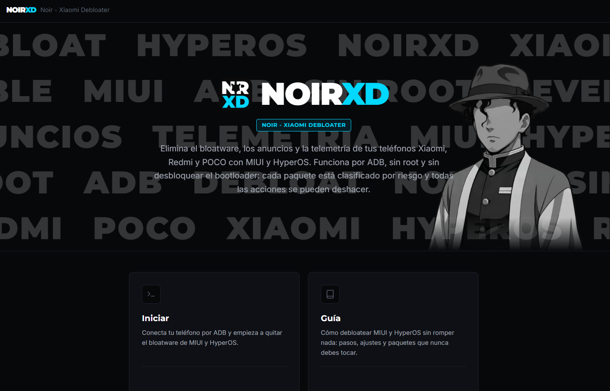
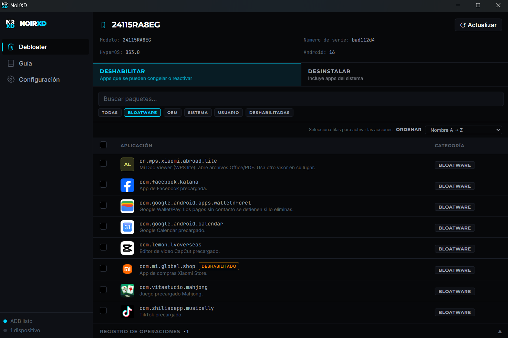

# NoirXD — elimina el bloatware de MIUI y HyperOS sin root

**NoirXD** (anteriormente Xiaomi Debloater) es una app de escritorio gratuita y de código
abierto para eliminar bloatware, anuncios y telemetría de los teléfonos Xiaomi, Redmi y POCO
con **MIUI** o **HyperOS 1, 2 y 3**. Funciona por ADB, **sin root y sin desbloquear el
bootloader**, y corre en **Windows, macOS y Linux**.

A diferencia de las herramientas genéricas, se enfoca solo en Xiaomi: la lista de paquetes está
construida para MIUI y HyperOS, califica el riesgo de cada paquete y se actualiza con cada nueva
versión del sistema sin necesidad de reinstalar la app.

> **Aviso de fork:** NoirXD es un fork de
> [fadeltd/xiaomi-debloater](https://github.com/fadeltd/xiaomi-debloater) de
> **Fadel Trivandi Dipantara**, renombrado como NoirXD con interfaz en español (LatAm) y la
> identidad visual *Flat Noir*. Los releases se publican aquí y la lista de paquetes se
> mantiene en este repositorio. Ver [Créditos](#créditos).

## Características

- **640+ paquetes de MIUI / HyperOS** con descripciones claras y calificación de riesgo: 288
  seguros, 218 con precaución y 134 peligrosos ("nunca eliminar").
- **Siempre actualizada:** la app descarga la última lista de paquetes desde este repositorio,
  así que los paquetes nuevos de HyperOS se reconocen en cuanto se añaden aquí.
- **Reversible:** las apps se desinstalan solo para tu usuario (`pm uninstall -k --user 0`).
  Las apps eliminadas siguen listadas en la pestaña **Eliminadas** con un botón de restaurar;
  no se borra nada de la partición del sistema.
- **Deshabilitar, desinstalar, habilitar y restaurar** app por app, o eliminar muchas a la vez
  tras una confirmación.
- **Filtros** por Bloatware, OEM (apps de Xiaomi), Sistema, Usuario y Deshabilitadas, o
  búsqueda por nombre.
- **Guía integrada** para debloatear MIUI y HyperOS con seguridad, incluyendo ajustes de
  privacidad que no necesitan ADB.
- Detecta el modelo del teléfono, la versión de MIUI u HyperOS y la versión de Android.
- Cada acción queda registrada en el registro de operaciones.

## Teléfonos compatibles

Cualquier Xiaomi, Redmi o POCO con MIUI 12–14 o HyperOS 1, 2 o 3, incluidas ROMs Global, EEA,
India y China. Los paquetes de HyperOS 3 provienen del Xiaomi 15 Ultra y la mayoría de los
modelos actuales los comparten. Si falta un paquete de tu teléfono o está mal etiquetado,
[repórtalo](../../issues/new).

## Cómo debloatear tu teléfono Xiaomi

1. **Instala ADB.** macOS: `brew install android-platform-tools`. Windows:
   `winget install Google.PlatformTools`. Linux: `sudo apt install adb`.
2. **Activa las opciones de desarrollador:** Ajustes > Acerca del teléfono, toca *Versión de
   MIUI* o *Versión del OS* 7 veces.
3. **Activa la depuración por USB:** Ajustes > Ajustes adicionales > Opciones de
   desarrollador > *Depuración por USB*.
4. **Conecta el teléfono por USB** y toca *Permitir* en el aviso "¿Permitir depuración por
   USB?".
5. **Abre NoirXD.** Tu teléfono y sus paquetes aparecen en unos segundos.
6. Empieza por la pestaña **Bloatware** y los paquetes marcados como `seguro`. Deja en paz los
   paquetes `peligrosos`.

Lee la pestaña **Guía** de la app antes de eliminar nada marcado con `precaución`.

## Instalación

Descarga directa del último release para tu plataforma; los enlaces siempre apuntan a la
versión más reciente, o [compílala tú mismo](CONTRIBUTING.md#building-the-app).

| Plataforma | Archivo |
|---|---|
| Windows x64 | [noirxd-windows-amd64.exe](https://github.com/NOIR-DexPrkr/xiaomi-debloater/releases/latest/download/noirxd-windows-amd64.exe) |
| Windows ARM64 | [noirxd-windows-arm64.exe](https://github.com/NOIR-DexPrkr/xiaomi-debloater/releases/latest/download/noirxd-windows-arm64.exe) |
| macOS (Intel y Apple Silicon) | [noirxd-macos-universal.zip](https://github.com/NOIR-DexPrkr/xiaomi-debloater/releases/latest/download/noirxd-macos-universal.zip) |
| Linux (tar.gz) | [x64](https://github.com/NOIR-DexPrkr/xiaomi-debloater/releases/latest/download/noirxd-linux-amd64.tar.gz) o [ARM64](https://github.com/NOIR-DexPrkr/xiaomi-debloater/releases/latest/download/noirxd-linux-arm64.tar.gz) |
| Ubuntu, Debian, Mint | [.deb x64](https://github.com/NOIR-DexPrkr/xiaomi-debloater/releases/latest/download/noirxd-linux-amd64.deb) o [.deb ARM64](https://github.com/NOIR-DexPrkr/xiaomi-debloater/releases/latest/download/noirxd-linux-arm64.deb), luego `sudo apt install ./noirxd-linux-*.deb` |
| Fedora, openSUSE | [.rpm x64](https://github.com/NOIR-DexPrkr/xiaomi-debloater/releases/latest/download/noirxd-linux-amd64.rpm) o [.rpm ARM64](https://github.com/NOIR-DexPrkr/xiaomi-debloater/releases/latest/download/noirxd-linux-arm64.rpm), luego `sudo dnf install ./noirxd-linux-*.rpm` |

**macOS:** la app todavía no está notarizada por Apple, así que macOS bloquea el primer
arranque. Ejecuta `xattr -dr com.apple.quarantine "/Applications/NoirXD.app"`, o ábrela una vez
y luego haz clic en *Abrir de todos modos* en Ajustes > Privacidad y seguridad.

## Preguntas frecuentes

**¿Es seguro?** Los paquetes se eliminan solo para el usuario actual, así que se pueden
restaurar. Eliminar un paquete marcado como `peligroso` igual puede impedir que el teléfono
arranque bien, y la solución puede ser un restablecimiento de fábrica. Haz una copia de
seguridad antes.

**¿Cómo restauro una app eliminada?** Usa *Restaurar* en la app, o ejecuta
`adb shell cmd package install-existing <nombre.del.paquete>`. Un restablecimiento de fábrica
también restaura todo.

**¿Necesito root o un bootloader desbloqueado?** No. Todo funciona por ADB con la depuración
por USB.

**¿Las actualizaciones OTA seguirán funcionando?** Sí. Las desinstalaciones por usuario no
bloquean las actualizaciones, pero las actualizaciones grandes pueden devolver el bloat y añadir
paquetes nuevos. Actualiza la lista en la app y vuelve a revisar tras cada actualización del
sistema.

**¿En qué se diferencia de Universal Android Debloater?**
[UAD-ng](https://github.com/Universal-Debloater-Alliance/universal-android-debloater-next-generation)
es excelente y cubre todas las marcas. NoirXD se enfoca solo en Xiaomi, con la lista versionada
por MIUI/HyperOS y una guía específica de Xiaomi.

## Contribuir

Las correcciones de la lista de paquetes son la contribución más útil. Ver
[CONTRIBUTING.md](CONTRIBUTING.md).

## Créditos

**NoirXD es un fork de [Xiaomi Debloater](https://github.com/fadeltd/xiaomi-debloater),
creado por [Fadel Trivandi Dipantara](https://github.com/fadeltd)** y distribuido bajo licencia
GPL-3.0. Todo el trabajo original — el motor ADB, la lógica de desinstalación y la estructura
del proyecto — le pertenece; NoirXD le suma la interfaz en español, el rediseño *Flat Noir* y
la curaduría de la lista en este repositorio.

La lista de paquetes y la guía se compilaron a partir de, y el crédito correspondiente es para:
[UAD-ng](https://github.com/Universal-Debloater-Alliance/universal-android-debloater-next-generation),
[ovsky/hyperos-debloater](https://github.com/ovsky/hyperos-debloater),
[matthieu-pierson/debloat-hyperos-adb](https://github.com/matthieu-pierson/debloat-hyperos-adb),
[kirthandev/MIUI-Debloater-official](https://github.com/kirthandev/MIUI-Debloater-official),
[la lista de MIUI de KernelTruth](https://gist.github.com/KernelTruth/b85b55154c894ad77c6b62c01bfc4b50),
el [hilo de debloat del Xiaomi 15 Ultra en XDA](https://xdaforums.com/t/xiaomi-15-ultra-global-debloat-list.4726400/)
y la [guía de debloat y privacidad de r/miui](https://www.reddit.com/r/miui/comments/1sd50rf/the_ultimate_miui_debloat_privacy_guide_no_root/).

## Licencia

[GPL-3.0](LICENSE). Xiaomi, MIUI, HyperOS, Redmi y POCO son marcas de Xiaomi Inc. Este
proyecto no está afiliado ni respaldado por Xiaomi.
